# CI/CD Pipeline to Deploy Dockerized Application on Kubernetes using Jenkins

> **Academic / Practical Lab Assignment (5 Marks)**  
> **Topic:** Automated end-to-end CI/CD deployment of a containerized application to a Kubernetes cluster using a Jenkins Declarative Pipeline.

---

## 1. Project Overview & Architecture

This repository contains the complete codebase and automation scripts for building, testing, containerizing, and deploying a web application to a Kubernetes cluster through Jenkins.

### Pipeline Flow Diagram

```mermaid
flowchart LR
    A[Developer Git Push] --> B[Jenkins Pipeline Trigger]
    B --> C[Stage 1: Checkout SCM]
    C --> D[Stage 2: Run Unit Tests]
    D --> E[Stage 3: Docker Build & Tag]
    E --> F[Stage 4: Push to Docker Hub]
    F --> G[Stage 5: Deploy to Kubernetes]
    G --> H[Stage 6: Verify Rollout Status]
    H --> I[Live App on K8s Cluster]
```


---

## 2. Directory Structure

```text
d:\jenkins\
├── app.py                  # Flask Application Source Code
├── requirements.txt        # Python Dependencies (Flask, Pytest)
├── test_app.py             # Automated Unit Tests
├── Dockerfile              # Container definition for the app
├── .dockerignore           # Ignored files for Docker build
├── Jenkinsfile             # Declarative Pipeline for Linux/Standard Agents
├── Jenkinsfile.windows     # Declarative Pipeline for Windows Agents
├── k8s/
│   ├── deployment.yaml     # Kubernetes Deployment definition (2 replicas, health probes)
│   └── service.yaml        # Kubernetes NodePort Service (Port 30080)
└── README.md               # Complete Setup & Lab Submission Guide
```

---

## 3. Application Details

The sample application is built with **Python Flask**:
- Root endpoint `/`: Returns a JSON response with status, message, app version, and the Kubernetes Pod hostname serving the request.
- Health endpoint `/health`: Serves as the liveness/readiness probe target for Kubernetes.

---

## 4. Step-by-Step Setup & Execution Guide

### Step 1: Install Required Jenkins Plugins
Navigate to **Jenkins Dashboard** -> **Manage Jenkins** -> **Plugins** -> **Available Plugins** and install:
1. `Git Plugin`
2. `Docker Pipeline`
3. `Credentials Binding Plugin`
4. `Kubernetes CLI Plugin` (optional, for `withKubeConfig`)

Restart Jenkins if prompted.

---

### Step 2: Configure Credentials in Jenkins
Navigate to **Manage Jenkins** -> **Credentials** -> **System** -> **Global credentials (unrestricted)** -> **Add Credentials**:

1. **Docker Hub Credentials**:
   - **Kind**: `Username with password`
   - **ID**: `dockerhub-credentials`
   - **Username**: Your Docker Hub username (e.g. `nikhilchowdary`)
   - **Password**: Your Docker Hub password or Personal Access Token (PAT)

2. **Kubernetes Configuration**:
   - **Kind**: `Secret file`
   - **ID**: `k8s-kubeconfig`
   - **File**: Upload your cluster `config` file (found at `~/.kube/config` or `%USERPROFILE%\.kube\config`)

---

### Step 3: Create the Jenkins Pipeline Job
1. In Jenkins, click **New Item**.
2. Enter item name: `k8s-docker-cicd-pipeline`.
3. Select **Pipeline** and click **OK**.
4. Scroll to the **Pipeline** section:
   - **Definition**: Choose **Pipeline script from SCM** (or **Pipeline script** to paste directly).
   - **SCM**: Git
   - **Repository URL**: Your Git repository URL containing this folder.
   - **Script Path**: `Jenkinsfile` (or `Jenkinsfile.windows` if using Windows agent).
5. Click **Save**.

---

### Step 4: Run the Pipeline
1. Click **Build Now** on the left menu.
2. Watch the Stage View progress through:
   - `Checkout SCM` (Green)
   - `Run Unit Tests` (Green)
   - `Build Docker Image` (Green)
   - `Push Docker Image` (Green)
   - `Deploy to Kubernetes` (Green)
   - `Verify Deployment` (Green)

---

## 5. Verification & Testing

Run the following commands in terminal / CLI to verify the deployment:

```bash
# 1. Check Pods status (should show 2 replicas running)
kubectl get pods -l app=flask-k8s-app

# 2. Check Service status
kubectl get svc flask-k8s-service

# 3. Access the application
# If using Minikube:
minikube service flask-k8s-service

# If using local Kubernetes / Docker Desktop:
curl http://localhost:30080
# or open in browser: http://localhost:30080
```

### Expected Output from `/`:
```json
{
  "details": "Application successfully deployed on Kubernetes using Jenkins",
  "message": "Welcome to CI/CD Pipeline Demo!",
  "pod_name": "flask-k8s-deployment-788b776c5b-x9abc",
  "status": "success",
  "version": "1.0.0"
}
```

---

## 6. Viva-Voce / Exam Questions (5-Mark Evaluation)

1. **What is the role of CI/CD in this setup?**
   - *CI (Continuous Integration)* automatically validates code changes via unit tests and builds container images.
   - *CD (Continuous Deployment)* automatically pushes artifacts to a container registry and rolls out updates to the Kubernetes cluster without manual intervention.

2. **Why use a Docker image tag like `${BUILD_NUMBER}` instead of just `latest`?**
   - Using unique build numbers ensures immutability, traceability, and enables easy rollbacks to specific prior versions if a deployment fails.

3. **What is the purpose of Liveness and Readiness probes in Kubernetes?**
   - *Liveness Probe*: Detects if the container is stuck or dead; restarts it if failing.
   - *Readiness Probe*: Determines if the container is ready to accept traffic; prevents sending requests to unready pods.

4. **How does Jenkins securely handle Docker Hub and Kubernetes credentials?**
   - Jenkins stores sensitive secrets encrypted in its credential store. Through the `withCredentials` block, secrets are injected as masked environment variables during runtime without exposing plaintext values in logs or scripts.
